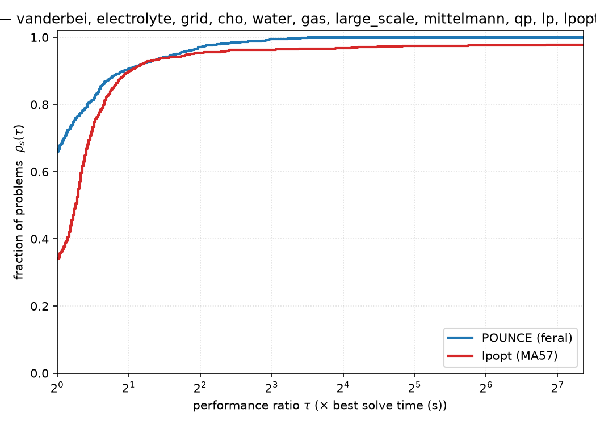
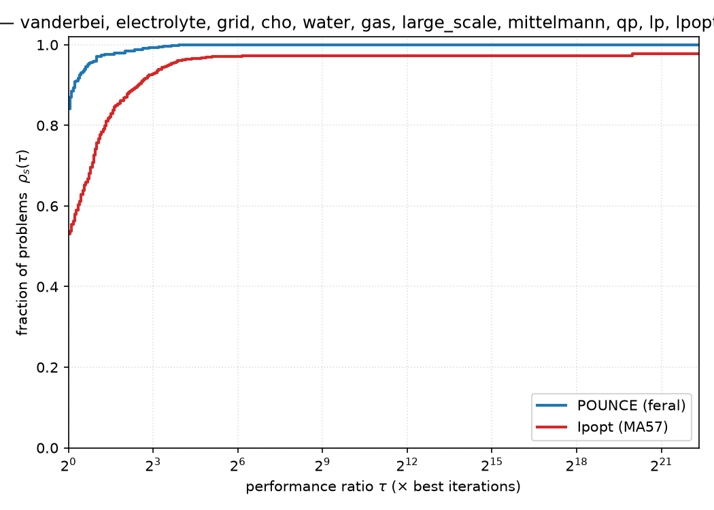
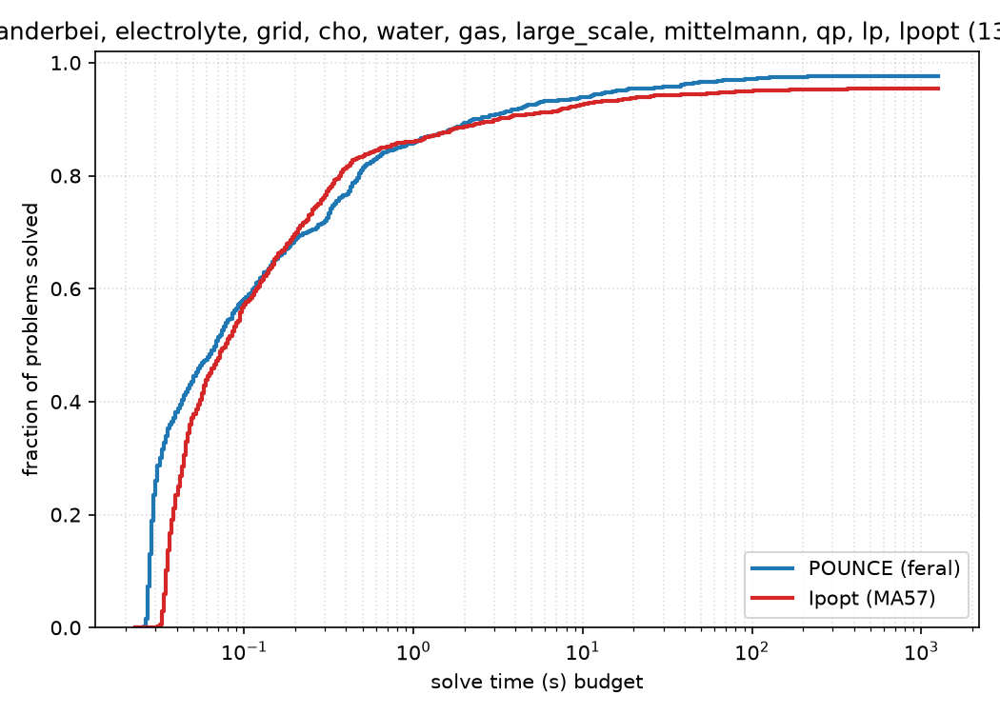

# POUNCE Benchmark Report

Generated: 2026-10-28 05:36:58

## Provenance

| Component | Version / Detail |
|-----------|------------------|
| POUNCE | v0.13.0 (HEAD @ c082fe76) |
| POUNCE binary | pounce 0.13.0 (commit c082fe76, built 2026-10-28T06:07:11Z) |
| POUNCE linear solver | feral (default) |
| Ipopt | Ipopt 3.14.20 (Darwin arm64), ASL(20241202) |
| Ipopt linear solver | ma57 (via ref/Ipopt/install-ma57) |
| Platform | Darwin 25.6.0 arm64 |

POUNCE results were produced this run by `make -C benchmarks
<suite>-run` (pounce only). The Ipopt column is a saved reference
(`make -C benchmarks ipopt-reference`), rerun only when explicitly
regenerated — generated 2026-06-11 21:49:49 EDT on Johns-Mac-mini.local (Darwin 25.5.0 arm64), git 659d98a, timelimit 300s. Ipopt solve *times* are
from that reference machine and only comparable to POUNCE when this
report is generated on the same host.

The GAMS solver-link path is exercised separately as a liveness
smoke check (`make -C benchmarks gams-bench`) and is not aggregated here.

> **Threading & timing.** These POUNCE runs carry no per-suite thread stamp — they predate it, so the
> settings they ran under were not recorded.
> At report time they are not pinned (`OMP_NUM_THREADS` unset, `OPENBLAS_NUM_THREADS` unset, `VECLIB_MAXIMUM_THREADS` unset, `RAYON_NUM_THREADS` unset), which says nothing about the runs themselves.
> Treat POUNCE-vs-Ipopt time comparisons below as unverified on this axis.

> **Time limits.** The saved Ipopt reference ran at `max_cpu_time` = 300s unless overridden below. The POUNCE arm carries no time-limit flag — it is wrapped in `timeout $BENCH_TIMELIMIT` and a kill is recorded as `Maximum_CpuTime_Exceeded` — but the limit in force is stamped per suite into `<suite>/pounce.env.json` and is read from there below.
> Override — **mittelmann**: Ipopt reference at 1800s (regenerated 2026-08-07, threads pinned to 1 (OMP/OPENBLAS/VECLIB/RAYON)).
> Reason given: the 300s max_cpu_time in the base stamp was reached at ~90s wall on unpinned multithreaded BLAS, leaving 6 instances truncated; see dev-notes/research/mittelmann-post-546-sweep.md
> POUNCE ran this suite at 300s (recorded in `pounce.env.json`) against the reference's 1800s, so the two columns are **not** held to the same clock here.
> Decided by that gap: **WM_CFy** — POUNCE cut off at 300s (226 iters), Ipopt Optimal at 1147s (556 iters), i.e. past POUNCE's cutoff. It is counted here as an Ipopt-only solve, on a limit POUNCE was never given. Measured out of band on 2026-08-11 at the reference's own 1800s limit (same host, threads pinned, binary from ce41b5bc): POUNCE returns `Optimal Solution Found` in 673s / 239 iterations, vs Ipopt's 1147s / 556. Objectives differ by 0.136% (two local optima; Ipopt's is the better point). Deliberately not merged into the results, which record the sweep as configured — see dev-notes/research/wm-cfy-timelimit.md.

## Executive Summary

| Metric | POUNCE | Ipopt |
|--------|--------|-------|
| Optimal (strict) | **1308/1345** (97.2%) | **1260/1345** (93.7%) |
| Acceptable (informational, *not* counted as solved) | 4 | 24 |
| Solved exclusively (strict Optimal) | 51 | 3 |
| Both Optimal | 1257 | |
| Matching objectives (< 0.01%) | 1195/1257 | |

> **Note:** All headline counts use strict Optimal status only. `Acceptable`
> means the iterate met relaxed tolerances but not the requested tolerance —
> per CLAUDE.md's "Honesty in Benchmarks" rule it is reported separately and
> never folded into the pass rate. See the "Acceptable (not Optimal)" and
> "Different Local Minima" sections below.

## Performance Profiles

[Dolan & Moré (2002)](https://doi.org/10.1007/s101070100263) performance profiles pooled over every suite with an Ipopt reference. ρ_s(τ) is the fraction of problems a solver solves within a factor τ of the fastest solver on each problem: the **height at τ=1** is how often it was the quickest, and the **right-hand plateau** is its overall robustness (fraction solved at all). A problem counts as solved only at strict/acceptable success; failures and timeouts are charged infinite cost. Regenerate or slice these with `python3 scripts/perf_profile.py <suite…> [--metric iters] [--mode data]`.

**Performance profile by wall-clock time.** Valid because POUNCE and Ipopt-MA57 were run interleaved on this host (see Provenance).
  
_1313 problems; solvers: pounce, ipopt._

**Performance profile by iteration count** — machine-independent, so it stays comparable across hosts and reruns.
  
_1313 problems; solvers: pounce, ipopt._

**Data profile (absolute-time ECDF).** Fraction of problems solved within a given wall-clock budget, without best-solver normalization — reads directly as “how many by 1 s? by 10 s?”.
  
_1345 problems; solvers: pounce, ipopt._

## Per-Suite Summary

| Suite | Problems | POUNCE Optimal | Ipopt Optimal | POUNCE only | Ipopt only | Both Optimal | Match |
|-------|----------|---------------|--------------|-------------|------------|--------------|-------|
| Vanderbei | 733 | 704 (96.0%) | 683 (93.2%) | 23 | 2 | 681 | 657/681 |
| Electrolyte | 13 | 13 (100.0%) | 13 (100.0%) | 0 | 0 | 13 | 13/13 |
| Grid | 22 | 22 (100.0%) | 22 (100.0%) | 0 | 0 | 22 | 22/22 |
| CHO | 1 | 1 (100.0%) | 1 (100.0%) | 0 | 0 | 1 | 1/1 |
| Water | 6 | 6 (100.0%) | 6 (100.0%) | 0 | 0 | 6 | 3/6 |
| Gas | 4 | 3 (75.0%) | 3 (75.0%) | 0 | 0 | 3 | 3/3 |
| LargeScale | 6 | 6 (100.0%) | 6 (100.0%) | 0 | 0 | 6 | 6/6 |
| Mittelmann | 47 | 44 (93.6%) | 41 (87.2%) | 4 | 1 | 40 | 38/40 |
| QP | 138 | 138 (100.0%) | 133 (96.4%) | 5 | 0 | 133 | 125/133 |
| LP | 371 | 369 (99.5%) | 352 (94.9%) | 17 | 0 | 352 | 327/352 |
| LPopt | 4 | 2 (50.0%) | 0 (0.0%) | 2 | 0 | 0 | 0/1 |

## Vanderbei Reference Cross-Check

Per-problem status from R. Vanderbei's `cute_table.pdf` (`vanderbei/cute_table_status.json`). The meaningful denominator is the **expected-solvable** set — problems with a documented finite optimum — not all 733: the CUTE collection deliberately includes unbounded, infeasible, and no-solver-finishes problems.

| cute_table status | problems | POUNCE solved | meaning |
|---|---|---|---|
| optimum | 684 | 669 | finite reference optimum exists (expected-solvable) |
| hard | 14 | 8 | in table, but SNOPT+NITRO+LOQO all hit time/iter limits |
| infeasible | 3 | 0 | a reference solver declared infeasibility |
| unbounded | 1 | 0 | unbounded below |
| untabulated | 31 | 27 | not in cute_table — no reference datum |

**POUNCE solved 669 / 684 expected-solvable (97.8%).** The hard / infeasible / unbounded / untabulated rows above are excluded from this denominator — a POUNCE failure there is shared with the commercial reference solvers and is not counted as a miss.

**Genuine misses — expected-solvable but POUNCE did not reach Optimal (15):**

> coshfun cresc100 cresc50 deconvb flosp2hh grouping himmelbj nonmsqrt orthrds2 palmer5e polak3 sineali ssebnln steenbrc steenbrf

**Objective disagreements vs. cute_table reference (22)** — POUNCE converged but to a different value than the agreed reference optimum (possible wrong basin or misread problem):

| Problem | POUNCE obj | reference obj | rel. diff |
|---|---|---|---|
| broydn7d | 3.450050e+02 | 3.823419e+00 | 8.9e+01 |
| liswet9 | 1.963305e+03 | 2.499976e+01 | 7.8e+01 |
| liswet8 | 7.144874e+02 | 2.499977e+01 | 2.8e+01 |
| liswet7 | 4.987922e+02 | 2.499979e+01 | 1.9e+01 |
| eigenbco | 4.732879e-19 | 9.000000e+00 | 1.0e+00 |
| liswet10 | 4.948391e+01 | 2.499967e+01 | 9.8e-01 |
| orthregd | 1.523900e+03 | 4.245801e+04 | 9.6e-01 |
| orthrgds | 1.523900e+03 | 2.603509e+04 | 9.4e-01 |
| bt4 | -3.704768e+00 | -4.551055e+01 | 9.2e-01 |
| camel6 | -2.154638e-01 | -1.031628e+00 | 7.9e-01 |
| liswet1 | 3.612062e+01 | 2.500304e+01 | 4.4e-01 |
| fletcher | 1.165685e+01 | 1.952537e+01 | 4.0e-01 |
| liswet12 | -3.314381e+03 | -5.026353e+03 | 3.4e-01 |
| britgas | -1.887194e-01 | 2.313955e-08 | 1.9e-01 |
| cresc132 | 8.577054e-01 | 6.848460e-01 | 1.7e-01 |
| hs044 | -1.300000e+01 | -1.500000e+01 | 1.3e-01 |
| avgasb | -4.483219e+00 | -4.132819e+00 | 8.5e-02 |
| steenbre | 2.851495e+04 | 2.745916e+04 | 3.8e-02 |
| haldmads | 3.303041e-02 | 1.223712e-04 | 3.3e-02 |
| errinros | 4.040449e+01 | 3.990415e+01 | 1.3e-02 |
| twirism1 | -1.001902e+00 | -1.006758e+00 | 4.8e-03 |
| trainh | 1.231197e+01 | 1.236996e+01 | 4.7e-03 |

## Vanderbei Suite — Performance

On 681 commonly-solved problems:

| Metric | POUNCE | Ipopt |
|--------|--------|-------|
| Median time | 31.6ms | 44.3ms |
| Total time | 275.46s | 234.88s |
| Mean iterations | 45.4 | 47.2 |
| Median iterations | 15 | 16 |

- **Geometric mean speedup**: 1.1x
- **Median speedup**: 1.2x
- POUNCE faster: 504/681 (74%)
- POUNCE 10x+ faster: 1/681
- Ipopt faster: 177/681

## Electrolyte Suite — Performance

On 13 commonly-solved problems:

| Metric | POUNCE | Ipopt |
|--------|--------|-------|
| Median time | 27.5ms | 37.6ms |
| Total time | 364.6ms | 503.3ms |
| Mean iterations | 9.5 | 12.2 |
| Median iterations | 7 | 10 |

- **Geometric mean speedup**: 1.4x
- **Median speedup**: 1.3x
- POUNCE faster: 13/13 (100%)
- POUNCE 10x+ faster: 0/13
- Ipopt faster: 0/13

## Grid Suite — Performance

On 22 commonly-solved problems:

| Metric | POUNCE | Ipopt |
|--------|--------|-------|
| Median time | 203.3ms | 88.5ms |
| Total time | 88.48s | 27.54s |
| Mean iterations | 57.3 | 59.7 |
| Median iterations | 36 | 36 |

- **Geometric mean speedup**: 0.5x
- **Median speedup**: 0.5x
- POUNCE faster: 4/22 (18%)
- POUNCE 10x+ faster: 0/22
- Ipopt faster: 18/22

## CHO Suite — Performance

On 1 commonly-solved problems:

| Metric | POUNCE | Ipopt |
|--------|--------|-------|
| Median time | 3.13s | 1.76s |
| Total time | 3.13s | 1.76s |
| Mean iterations | 31.0 | 33.0 |
| Median iterations | 31 | 33 |

- **Geometric mean speedup**: 0.6x
- **Median speedup**: 0.6x
- POUNCE faster: 0/1 (0%)
- POUNCE 10x+ faster: 0/1
- Ipopt faster: 1/1

## Water Suite — Performance

On 6 commonly-solved problems:

| Metric | POUNCE | Ipopt |
|--------|--------|-------|
| Median time | 95.4ms | 122.5ms |
| Total time | 738.5ms | 696.0ms |
| Mean iterations | 233.5 | 205.2 |
| Median iterations | 197 | 209 |

- **Geometric mean speedup**: 1.0x
- **Median speedup**: 1.0x
- POUNCE faster: 2/6 (33%)
- POUNCE 10x+ faster: 0/6
- Ipopt faster: 4/6

## Gas Suite — Performance

On 3 commonly-solved problems:

| Metric | POUNCE | Ipopt |
|--------|--------|-------|
| Median time | 80.8ms | 113.3ms |
| Total time | 277.4ms | 374.0ms |
| Mean iterations | 39.7 | 39.7 |
| Median iterations | 20 | 20 |

- **Geometric mean speedup**: 1.4x
- **Median speedup**: 1.4x
- POUNCE faster: 3/3 (100%)
- POUNCE 10x+ faster: 0/3
- Ipopt faster: 0/3

## LargeScale Suite — Performance

On 6 commonly-solved problems:

| Metric | POUNCE | Ipopt |
|--------|--------|-------|
| Median time | 3.19s | 1.27s |
| Total time | 107.56s | 119.55s |
| Mean iterations | 314.2 | 295.2 |
| Median iterations | 13 | 6 |

- **Geometric mean speedup**: 0.6x
- **Median speedup**: 1.2x
- POUNCE faster: 3/6 (50%)
- POUNCE 10x+ faster: 0/6
- Ipopt faster: 3/6

## Mittelmann Suite — Performance

On 40 commonly-solved problems:

| Metric | POUNCE | Ipopt |
|--------|--------|-------|
| Median time | 10.31s | 6.88s |
| Total time | 850.25s | 1488.30s |
| Mean iterations | 92.3 | 110.7 |
| Median iterations | 42 | 55 |

- **Geometric mean speedup**: 0.8x
- **Median speedup**: 0.7x
- POUNCE faster: 15/40 (38%)
- POUNCE 10x+ faster: 4/40
- Ipopt faster: 25/40

## QP Suite — Performance

On 133 commonly-solved problems:

| Metric | POUNCE | Ipopt |
|--------|--------|-------|
| Median time | 77.9ms | 92.9ms |
| Total time | 96.78s | 172.97s |
| Mean iterations | 19.8 | 75.6 |
| Median iterations | 18 | 24 |

- **Geometric mean speedup**: 1.2x
- **Median speedup**: 1.2x
- POUNCE faster: 87/133 (65%)
- POUNCE 10x+ faster: 2/133
- Ipopt faster: 46/133

## LP Suite — Performance

On 352 commonly-solved problems:

| Metric | POUNCE | Ipopt |
|--------|--------|-------|
| Median time | 148.4ms | 157.8ms |
| Total time | 324.03s | 422.20s |
| Mean iterations | 35.5 | 107.3 |
| Median iterations | 24 | 56 |

- **Geometric mean speedup**: 1.1x
- **Median speedup**: 1.0x
- POUNCE faster: 186/352 (53%)
- POUNCE 10x+ faster: 8/352
- Ipopt faster: 166/352

## Failure Analysis

### Vanderbei Suite

| Failure Mode | POUNCE | Ipopt |
|-------------|--------|-------|
| Acceptable | 4 | 6 |
| Diverging_Iterates | 3 | 0 |
| Infeasible_Problem_Detected | 1 | 4 |
| Invalid_Number_Detected | 1 | 3 |
| Maximum_CpuTime_Exceeded | 2 | 8 |
| Maximum_Iterations_Exceeded | 13 | 16 |
| Not_Enough_Degrees_Of_Freedom | 2 | 0 |
| Restoration_Failed | 1 | 3 |
| Search_Direction_Becomes_Too_Small | 0 | 1 |
| Solver_Error | 2 | 2 |
| Unknown_Error | 0 | 7 |

### Gas Suite

| Failure Mode | POUNCE | Ipopt |
|-------------|--------|-------|
| Infeasible_Problem_Detected | 1 | 1 |

### Mittelmann Suite

| Failure Mode | POUNCE | Ipopt |
|-------------|--------|-------|
| Maximum_CpuTime_Exceeded | 3 | 2 |
| Maximum_Iterations_Exceeded | 0 | 3 |
| Solver_Error | 0 | 1 |

### QP Suite

| Failure Mode | POUNCE | Ipopt |
|-------------|--------|-------|
| Acceptable | 0 | 4 |
| Maximum_CpuTime_Exceeded | 0 | 1 |

### LP Suite

| Failure Mode | POUNCE | Ipopt |
|-------------|--------|-------|
| Acceptable | 0 | 14 |
| Infeasible_Problem_Detected | 2 | 1 |
| Maximum_CpuTime_Exceeded | 0 | 1 |
| Maximum_Iterations_Exceeded | 0 | 1 |
| Restoration_Failed | 0 | 1 |
| Unknown_Error | 0 | 1 |

### LPopt Suite

| Failure Mode | POUNCE | Ipopt |
|-------------|--------|-------|
| Maximum_CpuTime_Exceeded | 2 | 4 |

## Regressions (Ipopt Optimal, POUNCE not Optimal)

| Problem | Suite | n | m | POUNCE status | Ipopt obj |
|---------|-------|---|---|--------------|-----------|
| WM_CFy | Mittelmann | 8709 | 12850 | Maximum_CpuTime_Exceeded | 1.221824e+00 |
| orthrds2 | Vanderbei | 203 | 100 | Acceptable | 1.544297e+03 |
| ssebnln | Vanderbei | 194 | 96 | Acceptable | 1.617060e+07 |

## Wins (POUNCE Optimal, Ipopt not Optimal) — 51 problems

| Problem | Suite | n | m | Ipopt status | POUNCE obj |
|---------|-------|---|---|-------------|------------|
| BOYD1 | QP | 93261 | 18 | Acceptable | -6.173522e+07 |
| BOYD2 | QP | 93263 | 186531 | Maximum_CpuTime_Exceeded | 2.125677e+01 |
| QPILOTNO | QP | 2172 | 975 | Acceptable | 4.728587e+06 |
| QRECIPE | QP | 180 | 91 | Acceptable | -2.666160e+02 |
| QSCORPIO | QP | 358 | 388 | Acceptable | 1.880510e+03 |
| aa4 | LP | 7195 | 426 | Acceptable | 2.587761e+04 |
| air05 | LP | 7195 | 426 | Acceptable | 2.587761e+04 |
| bore3d | LP | 315 | 233 | Acceptable | 1.373080e+03 |
| brainpc0 | Vanderbei | 6905 | 6900 | Restoration_Failed | 1.499639e-03 |
| brainpc1 | Vanderbei | 6905 | 6900 | Restoration_Failed | 4.077592e-04 |
| brainpc2 | Vanderbei | 13805 | 13800 | Maximum_CpuTime_Exceeded | 4.116990e-04 |
| brainpc5 | Vanderbei | 6905 | 6900 | Maximum_CpuTime_Exceeded | 3.750403e-04 |
| brainpc7 | Vanderbei | 6905 | 6900 | Maximum_CpuTime_Exceeded | 3.927065e-04 |
| britgas | Vanderbei | 450 | 360 | Maximum_Iterations_Exceeded | -1.887194e-01 |
| bt8 | Vanderbei | 5 | 2 | Acceptable | 1.000000e+00 |
| co5 | LP | 7993 | 5715 | Acceptable | 7.144696e+05 |
| complex | LP | 1408 | 1023 | Acceptable | -9.966667e+01 |
| coolhans | Vanderbei | 9 | 0 | Unknown_Error | 0.000000e+00 |
| cq5 | LP | 7530 | 5025 | Acceptable | 4.001338e+05 |
| cresc132 | Vanderbei | 6 | 2654 | Infeasible_Problem_Detected | 8.577054e-01 |
| csfi2 | Vanderbei | 5 | 4 | Acceptable | 5.501760e+01 |
| cvxqp3 | Vanderbei | 10000 | 7500 | Maximum_CpuTime_Exceeded | 1.157111e+08 |
| dallasl | Vanderbei | 906 | 667 | Invalid_Number_Detected | -2.026041e+05 |
| dallasm | Vanderbei | 196 | 151 | Invalid_Number_Detected | -4.819819e+04 |
| dallass | Vanderbei | 46 | 31 | Invalid_Number_Detected | -3.239323e+04 |
| de063155 | LP | 1488 | 852 | Restoration_Failed | 9.883094e+09 |
| drcav2lq | Vanderbei | 10816 | 816 | Maximum_CpuTime_Exceeded | 1.066177e-03 |
| drcavty2 | Vanderbei | 10816 | 816 | Maximum_CpuTime_Exceeded | 1.066177e-03 |
| eigenc2 | Vanderbei | 462 | 231 | Unknown_Error | 7.718095e+02 |
| finnis | LP | 614 | 497 | Acceptable | 1.727911e+05 |
| flosp2th | Vanderbei | 691 | 0 | Maximum_Iterations_Exceeded | 1.000000e+01 |
| greenbea | LP | 5405 | 2389 | Maximum_Iterations_Exceeded | -7.255525e+07 |
| greenbeb | LP | 5405 | 2389 | Acceptable | -4.302260e+06 |
| manne | Vanderbei | 1094 | 730 | Acceptable | -9.741053e-01 |
| maros | LP | 1443 | 845 | Acceptable | -5.806374e+04 |
| nql180 | Mittelmann | 129601 | 130080 | Solver_Error | -9.277211e-01 |
| palmer7e | Vanderbei | 8 | 0 | Maximum_Iterations_Exceeded | 1.015390e+01 |
| pilot.ja | LP | 1988 | 940 | Acceptable | -6.113136e+03 |
| pilotnov | LP | 2172 | 975 | Acceptable | -4.497276e+03 |
| polak6 | Vanderbei | 5 | 4 | Unknown_Error | -4.400000e+01 |
| qap15 | LPopt | 22275 | 6330 | Maximum_CpuTime_Exceeded | 1.040994e+03 |
| recipe | LP | 180 | 91 | Acceptable | -2.666160e+02 |
| robot_a | Mittelmann | 1001 | 52013 | Maximum_Iterations_Exceeded | 1.043192e+00 |
| robot_b | Mittelmann | 1001 | 52013 | Maximum_Iterations_Exceeded | 2.333099e+00 |
| robot_c | Mittelmann | 1001 | 52013 | Maximum_Iterations_Exceeded | 1.405976e+00 |
| scfxm1-2r-27 | LP | 6189 | 4088 | Acceptable | 2.886965e+03 |
| scorpion | LP | 358 | 388 | Acceptable | 1.878125e+03 |
| scrs8-2r-256 | LP | 9765 | 7196 | Maximum_CpuTime_Exceeded | 1.144161e+03 |
| steenbre | Vanderbei | 540 | 126 | Acceptable | 2.851495e+04 |
| steenbrg | Vanderbei | 540 | 126 | Acceptable | 2.747128e+04 |
| supportcase10 | LPopt | 14630 | 165684 | Maximum_CpuTime_Exceeded | 3.383924e+00 |

## Acceptable (not Optimal) — 4 problems

These problems converged within relaxed tolerances but not strict tolerances.

| Problem | Suite | n | m | Ipopt status | POUNCE obj | Ipopt obj |
|---------|-------|---|---|-------------|------------|-----------|
| orthrds2 | Vanderbei | 203 | 100 | Optimal | 1.461041e+03 | 1.544297e+03 |
| ssebnln | Vanderbei | 194 | 96 | Optimal | 1.617060e+07 | 1.617060e+07 |
| steenbrc | Vanderbei | 540 | 126 | Unknown_Error | 2.536280e+04 | 2.597624e+04 |
| steenbrf | Vanderbei | 468 | 108 | Acceptable | 4.697689e+02 | 1.321652e+03 |

## POUNCE-Only Suite Details

These suites currently run POUNCE only — no Ipopt-side comparison is captured in their result files. Per-problem timing and iteration counts are shown so users can inspect the whole picture.

### LPopt

| Problem | n | m | Status | Objective | Iters | Time |
|---------|---|---|--------|-----------|-------|------|
| ex10 | 17,680 | 69,608 | Maximum_CpuTime_Exceeded | N/A | 0 | 300.10s |
| irish-electricity | 61,728 | 104,259 | Maximum_CpuTime_Exceeded | N/A | 815 | 300.04s |
| qap15 | 22,275 | 6,330 | Optimal | 1.0410e+03 | 26 | 34.90s |
| supportcase10 | 14,630 | 165,684 | Optimal | 3.3839e+00 | 32 | 112.77s |

POUNCE: **2/4 Optimal** in 747.82s total

## Dedicated Convex Solver vs. General NLP (head-to-head)

The same LP / convex-QP `.nl` problems solved twice by the **same**
pounce binary: once routed to the dedicated convex interior-point
solver (`pounce-convex`, via `solver_selection=lp-ipm` / `qp-ipm`) and
once through the general NLP filter-IPM (`solver_selection=nlp`). This
quantifies the speedup the dedicated solver buys on its home turf. It
is a pounce-vs-pounce comparison and is independent of the Ipopt
reference used by the suites above.

> **The Ipopt-MA57 reference is a status and timing reference, not an
> objective oracle.** It carries Ipopt's `bound_relax_factor` widening,
> which changes the answer on constraint-degenerate models by `delta`
> times the bound's multiplier. On the `LISWET*` / `YAO` families POUNCE
> disagrees with it by tens of percent and POUNCE is correct: scored on
> the published Maros-Meszaros optima (DOC 97/6) the convex arm is
> 138/138 and Ipopt-MA57 misses 8. Score an objective disagreement
> against DOC 97/6 (`compare_qp_four_way.py`) before calling it a
> regression -- gh #744 was filed by not doing that.

### LP — convex vs NLP

| Metric | pounce-convex | pounce-nlp |
|--------|---------------|------------|
| Optimal | 358/371 (96.5%) | 360/371 (97.0%) |
| Solved exclusively | 9 | 11 |
| Both Optimal | 349 | |
| Matching objectives (< 0.01%) | 324/349 | |

On 349 problems solved by both arms:

| Metric | pounce-convex | pounce-nlp |
|--------|---------------|------------|
| Median time | 144.8ms | 175.8ms |
| Total time | 136.91s | 373.19s |
| Mean iterations | 25.6 | 105.1 |
| Median iterations | 24 | 56 |

- **Geometric-mean speedup (pounce-convex over pounce-nlp)**: 1.3x
- **Median speedup**: 1.1x
- pounce-convex faster: 225/349 (64%)
- pounce-convex 10x+ faster: 6/349
- pounce-nlp faster: 124/349

### QP — convex vs NLP

| Metric | pounce-convex | pounce-nlp |
|--------|---------------|------------|
| Optimal | 136/138 (98.6%) | 138/138 (100.0%) |
| Solved exclusively | 0 | 2 |
| Both Optimal | 136 | |
| Matching objectives (< 0.01%) | 128/136 | |

On 136 problems solved by both arms:

| Metric | pounce-convex | pounce-nlp |
|--------|---------------|------------|
| Median time | 76.5ms | 91.0ms |
| Total time | 369.80s | 344.05s |
| Mean iterations | 20.4 | 81.6 |
| Median iterations | 18 | 24 |

- **Geometric-mean speedup (pounce-convex over pounce-nlp)**: 1.0x
- **Median speedup**: 1.0x
- pounce-convex faster: 66/136 (49%)
- pounce-convex 10x+ faster: 1/136
- pounce-nlp faster: 70/136

### Mittelmann — exact vs L-BFGS

| Metric | exact Hessian | L-BFGS |
|--------|---------------|------------|
| Optimal | 44/47 (93.6%) | 32/47 (68.1%) |
| Solved exclusively | 14 | 2 |
| Both Optimal | 30 | |
| Matching objectives (< 0.01%) | 28/30 | |

On 30 problems solved by both arms:

| Metric | exact Hessian | L-BFGS |
|--------|---------------|------------|
| Median time | 10.92s | 10.46s |
| Total time | 551.02s | 724.43s |
| Mean iterations | 72.9 | 286.6 |
| Median iterations | 35 | 71 |

- **Geometric-mean speedup (exact Hessian over L-BFGS)**: 1.6x
- **Median speedup**: 1.7x
- exact Hessian faster: 22/30 (73%)
- exact Hessian 10x+ faster: 2/30
- L-BFGS faster: 8/30

---
*Generated by benchmark_report.py*